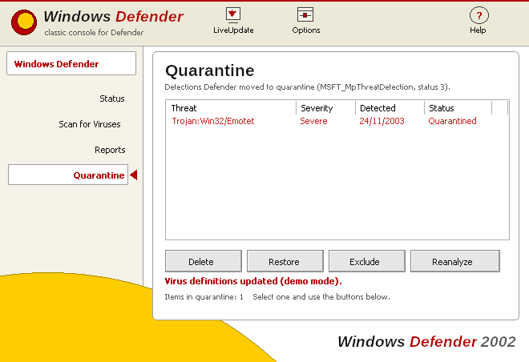
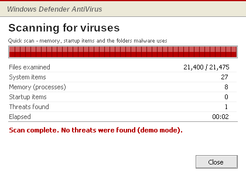
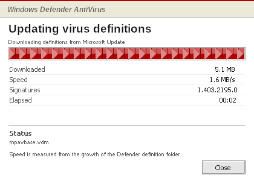
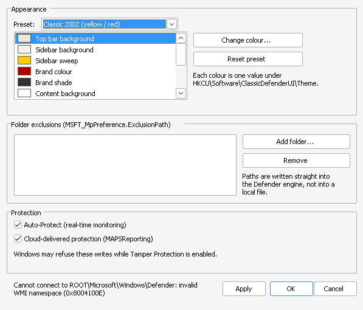

# ClassicDefenderUI

Win32 (C++17, GDI, no UWP and no .NET) front-end for the Microsoft Defender WMI
provider, drawn to look like Norton AntiVirus 2002. Resizable and maximizable
window (the 2002 layout reflows from its 660x452 design size), owner-draw
navigation, live-switchable colour themes.


## What it does

| Screen | Backed by |
| --- | --- |
| Status page (Auto-Protect, Incoming Email, Script Blocking, Full System Scan, definitions, service) | `MSFT_MpComputerStatus` |
| Scan page (quick / full / single folder) | `MSFT_MpScan.Start` |
| Reports page (`SysListView32` of recent detections) | `MSFT_MpThreatDetection` joined with `MSFT_MpThreat` |
| Quarantine page: Delete / Restore / Exclude / Reanalyze | `MSFT_MpThreatDetection` (status 3) + `MpCmdRun.exe -Remove/-Restore` + `MSFT_MpPreference.Add` + `MSFT_MpScan.Start` |
| LiveUpdate button | `MSFT_MpSignature.Update` |
| Options -> folder exclusions, Auto-Protect, cloud protection | `MSFT_MpPreference` `Add` / `Remove` / `Set` |
| Options -> colours | `HKCU\Software\ClassicDefenderUI` (preset index, one `REG_DWORD` per colour, 16-entry custom palette) |

Scans and LiveUpdate open their own progress window in the same skin: a
segmented 2002 bar, the files examined, the system, memory and startup items the
walk visited, the current path, and for updates the downloaded bytes, the
measured transfer rate and the signature version. Defender's provider only
reports start and finish, so those counters come from work this app does next to
the engine call (walking the same scope, polling the process list, measuring the
definition folder); the window says so in its footnote.

The window is a hand-drawn GDI skin: the header, the yellow sidebar swoosh, the
owner-draw navigation with its red marker, the status badges and the 2002-style
bevel buttons are all drawn by hand, so the colours chosen in *Options* repaint
the whole UI immediately. Three presets ship (classic 2002, blue, retro slate)
and the native `ChooseColorW` picker can change any single colour afterwards.







## Build

Windows (MSVC):

```bat
cmake -B build -A x64
cmake --build build --config Release
```

Linux cross-build (MinGW-w64):

```sh
cmake -B build -G Ninja -DCMAKE_TOOLCHAIN_FILE=cmake/toolchain-mingw-w64-x86_64.cmake -DBUILD_TESTING_TOOLS=ON
cmake --build build
```

`-DBUILD_TESTING_TOOLS=ON` also builds two console harnesses that run on Windows
(or Wine) and are wired into `ctest --test-dir build`: `theme_test.exe`
(exercises the real registry code) and `scope_test.exe` (builds a throwaway tree
under `%TEMP%` and checks the scope walk and the counters the progress window
shows).

## Running

Run the executable **elevated**: the Defender WMI provider rejects queries from
non-admin clients. The MSVC build embeds
`/MANIFESTUAC:level='requireAdministrator' uiAccess='false'`; the MinGW build
embeds `src/app.manifest` for the same effect.

`ClassicDefenderUI.exe --demo` renders the whole UI on sample data without
touching WMI, which is handy for layout work or for running under Wine. Adding
`--layout 900x640` resizes the window once at start-up, so the reflowing layout
can be captured without a window manager.

If Windows has Tamper Protection enabled, the protection toggles and the scans
fail with access denied; the UI maps the WBEM codes to a readable message
instead of failing silently.

## Notes

Layout work happens in 96 dpi logical units. The window paints through an
anisotropic mapping so the whole design, text included, scales with the monitor,
while child controls are positioned with `ui::Scale()`. See `AGENTS.md` for the
rest of the architecture rules.
