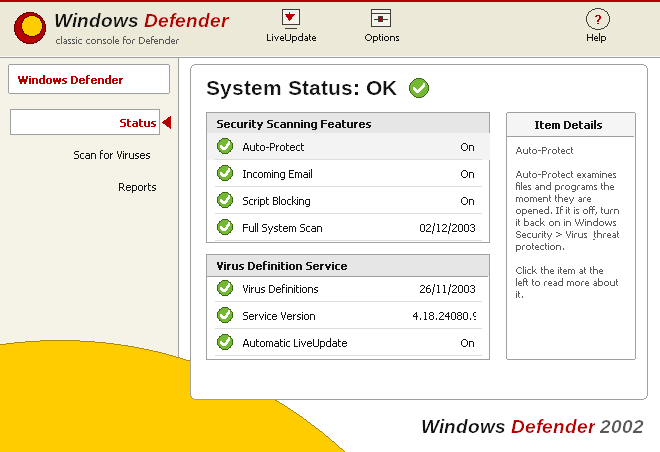
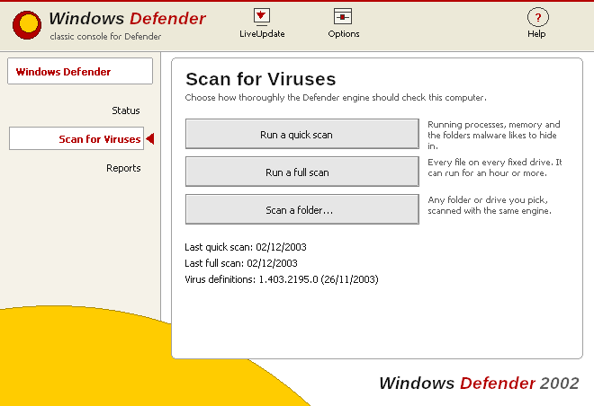
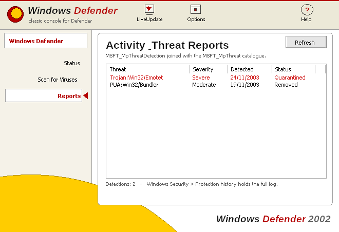

# ClassicDefenderUI

Win32 (C++17, GDI, no UWP and no .NET) front-end for the Microsoft Defender WMI
provider, drawn to look like Norton AntiVirus 2002. Fixed 660x452 window,
owner-draw navigation, live-switchable colour themes.



## What it does

| Screen | Backed by |
| --- | --- |
| Status page (Auto-Protect, Incoming Email, Script Blocking, Full System Scan, definitions, service) | `MSFT_MpComputerStatus` |
| Scan page (quick / full / single folder) | `MSFT_MpScan.Start` |
| Reports page (`SysListView32` of recent detections) | `MSFT_MpThreatDetection` joined with `MSFT_MpThreat` |
| LiveUpdate button | `MSFT_MpSignature.Update` |
| Options -> folder exclusions, Auto-Protect, cloud protection | `MSFT_MpPreference` `Add` / `Remove` / `Set` |
| Options -> colours | `HKCU\Software\ClassicDefenderUI` (preset index, one `REG_DWORD` per colour, 16-entry custom palette) |

The window is a fixed-size GDI skin: the header, the yellow sidebar swoosh, the
owner-draw navigation with its red marker, the status badges and the 2002-style
bevel buttons are all drawn by hand, so the colours chosen in *Options* repaint
the whole UI immediately. Three presets ship (classic 2002, blue, retro slate)
and the native `ChooseColorW` picker can change any single colour afterwards.





## Build

Windows (MSVC):

```bat
cmake -B build -A x64
cmake --build build --config Release
```

Linux cross-build (MinGW-w64):

```sh
cmake -B build -G Ninja -DCMAKE_TOOLCHAIN_FILE=cmake/toolchain-mingw-w64-x86_64.cmake -DBUILD_TESTING_TOOLS=ON
cmake --build build
```

`-DBUILD_TESTING_TOOLS=ON` also builds `theme_test.exe`, a console harness that
exercises the real registry code (`ctest --test-dir build`).

## Running

Run the executable **elevated**: the Defender WMI provider rejects queries from
non-admin clients. The MSVC build embeds
`/MANIFESTUAC:level='requireAdministrator' uiAccess='false'`; the MinGW build
embeds `src/app.manifest` for the same effect.

`ClassicDefenderUI.exe --demo` renders the whole UI on sample data without
touching WMI, which is handy for layout work or for running under Wine.

If Windows has Tamper Protection enabled, the protection toggles and the scans
fail with access denied; the UI maps the WBEM codes to a readable message
instead of failing silently.

## Notes

Layout work happens in 96 dpi logical units. The window paints through an
anisotropic mapping so the whole design, text included, scales with the monitor,
while child controls are positioned with `ui::Scale()`. See `AGENTS.md` for the
rest of the architecture rules.
